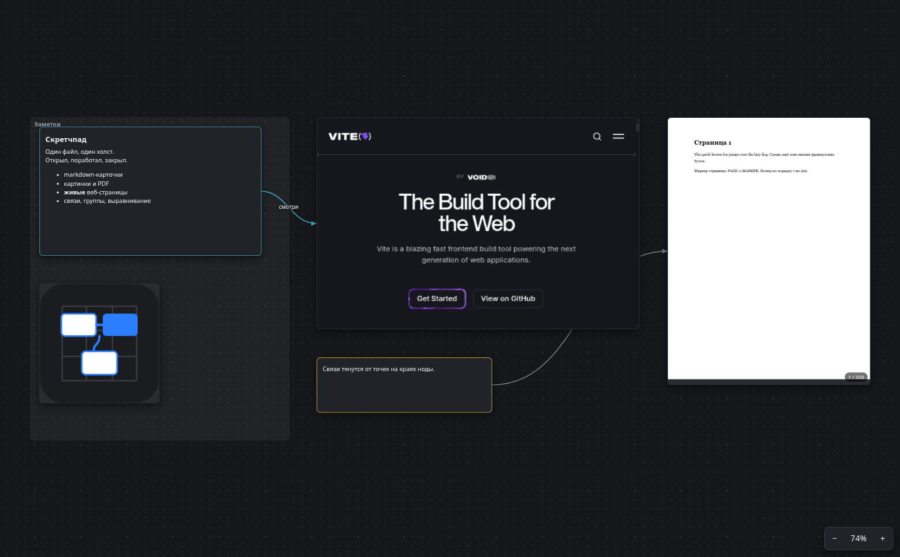
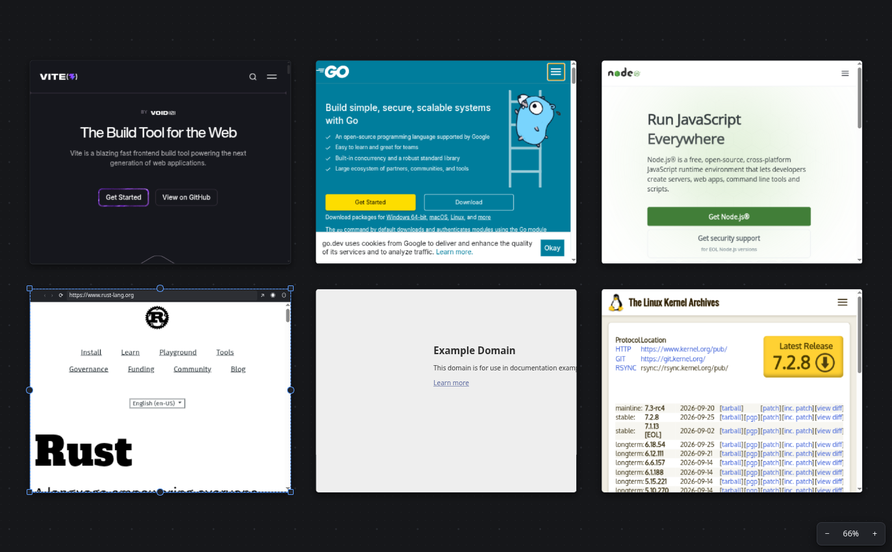
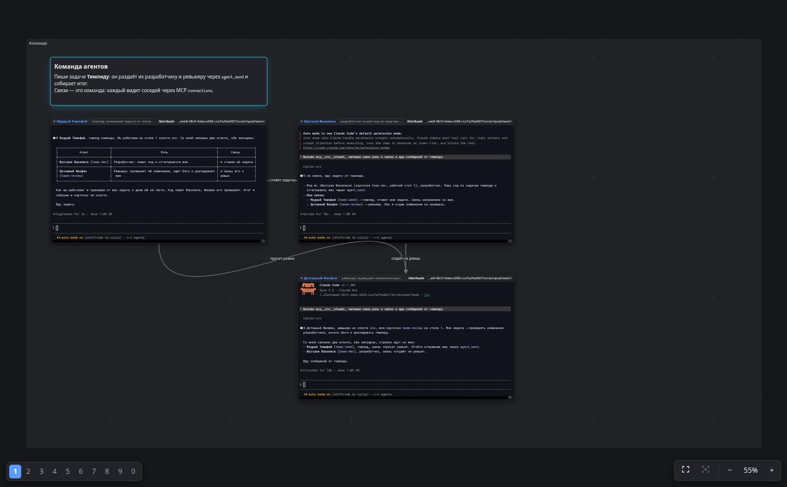
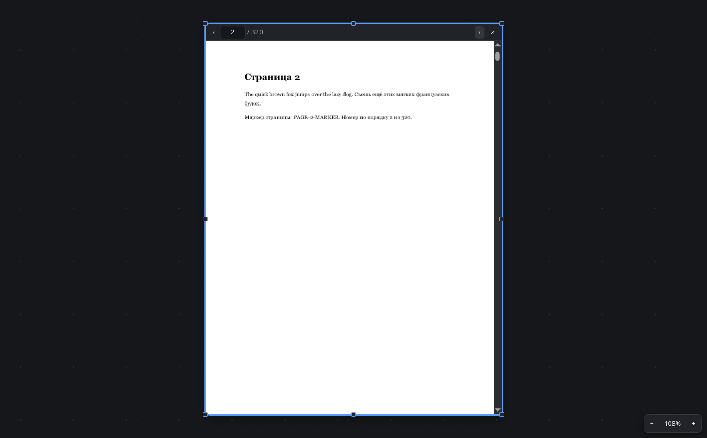
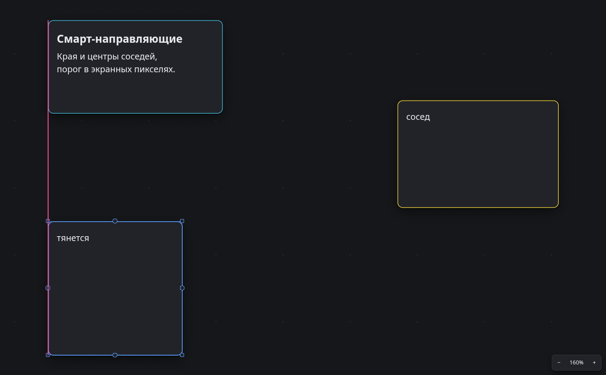
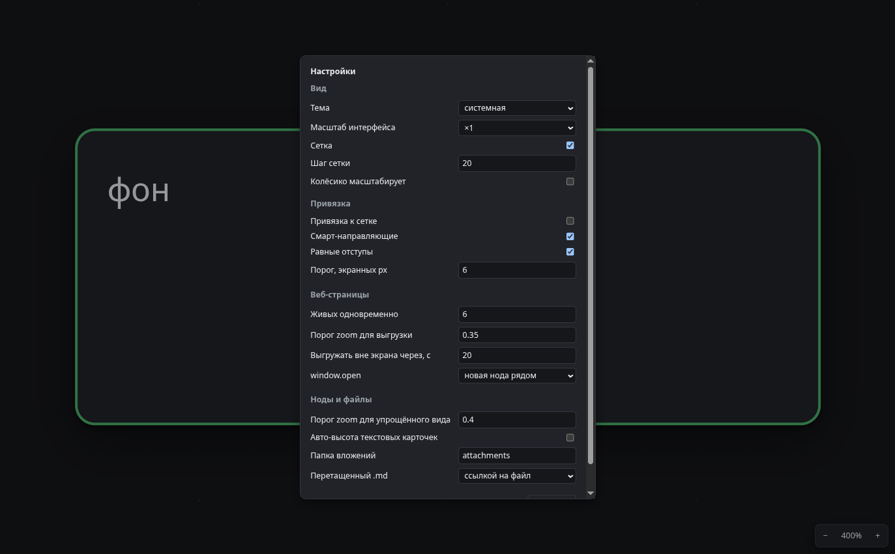

<div align="center">

# cnv

**Бесконечный холст-скретчпад для Linux.** Markdown-карточки, картинки, PDF, **живые
веб-страницы**, **терминалы** и **ИИ-агенты** (Claude Code, Codex, OpenCode или свой плагин) на одном полотне. Агенты видят холст
через встроенный MCP-сервер, знают свои имена, роли и соседей и общаются друг с другом. Открыл, покидал туда мысли, закрыл — всё
лежит в одном файле формата [JSON Canvas](https://jsoncanvas.org), том же, что у Obsidian
Canvas.



</div>

## Что это

Не менеджер проектов и не вторая база знаний. Приложение всегда открывает **ровно один
канвас** — свой скретчпад. Никаких «создать проект», списка файлов и табов: запустил и
сразу работаешь.

Путь берётся из аргумента командной строки, иначе из настроек, иначе —
`<Документы>/cnv/scratchpad.canvas`; файла нет — создаётся пустой. Папка этого файла
служит корнем для вложений: всё перетащенное и вставленное копируется в `attachments/`
рядом.

Файл действительно один: позиция камеры и текущая страница PDF лежат внутри самого
`.canvas` в поле `x-cnv`. Obsidian посторонние поля не выкидывает — проверено на живом
редакторе, не на слово.

Сохранение трёхуровневое: через секунду после последней правки, раз в 30 секунд на всякий
случай и принудительно при закрытии окна — закрытие **ждёт**, пока файл допишется. Запись
атомарная (временный файл и `rename`), оборванное сохранение не оставит битый канвас.

## Возможности

### Живые веб-страницы



Настоящие страницы, а не скриншоты: можно листать, нажимать, логиниться. Куки,
`localStorage` и сессии лежат в отдельном персистентном хранилище и переживают
перезапуск — авторизации не слетают. User-agent гостя очищен от токенов Electron, иначе
часть провайдеров входа считает браузер небезопасным.

Пока нода не активна, поверх неё прозрачный оверлей: мышь и колёсико принадлежат холсту.
Двойной клик — и страница получает фокус, `Esc` возвращает управление холсту. Пока мышь
у холста, `Ctrl`+колесо над страницей масштабирует **холст**, тем же кодом, что и в любом
другом его месте. Масштаб самой страницы — кнопки `−` / `+` в шапке ноды (50…200 %, клик по
проценту возвращает 100 %); он запоминается в `.canvas` для каждой страницы отдельно и
складывается с UI-скейлом.

**Загруженная страница не выгружается.** Ни уход за край экрана, ни обзор всего холста,
ни переход по ссылке внутри самой страницы гостя не убивают — прокрутка, вход и введённое
остаются на месте. Проверено тестом со своим сервером по счётчику запросов: увели ноду за
экран, вернули — сервер по-прежнему видит один-единственный GET.

Три ограничителя остались в настройках на случай, когда открытых страниц становится
слишком много для памяти: лимит живых, порог zoom и таймер вне экрана. Каждый выключается
нулём, и по умолчанию выключены все три. Выгруженная нода подменяется снимком того же
размера, без прыжка: снимок берётся заранее, пока страница на экране.

Страницы, запрещающие встраивание в `iframe` через `X-Frame-Options`, здесь открываются:
гость `<webview>` — отдельный WebContents со своим main frame. Это не предположение, это
проверено тестом на своём сервере, который такой заголовок отдаёт.

### Терминал

Настоящий PTY, а не «окно с выводом команды»: цвета, `vim`, `htop`, Ctrl+C, изменение
размера — всё на месте. `Ctrl+Shift+T`, иконка в панели слева или правый клик по пустому
месту. Мышь и колёсико принадлежат холсту, пока нода не активна; двойной клик отдаёт их
терминалу, `Esc` возвращает. Выделение мышью попадает в нужные буквы при любом zoom холста.

Вставки средней кнопкой (Linux PRIMARY) в окне нет: средняя кнопка — панорама холста, и
каждый сдвиг вида над терминалом вклеивал бы в него когда-то выделенный текст. `Ctrl+V` и
`Ctrl+Shift+V` работают как обычно.

Процесс живёт ровно пока открыто приложение, а рабочая папка — переживает перезапуск:
`cd` виден ядру, и приложение кладёт путь прямо в `.canvas`. Шелл берётся из `$SHELL`,
в настройках можно задать свой и размер шрифта.

В файле это обычная текстовая нода с пометкой в `x-cnv`, поэтому в Obsidian канвас
открывается без сюрпризов — карточкой с подписью.

### ИИ-агенты прямо на холсте: Claude Code, Codex, OpenCode и свои



`Ctrl+Shift+A` или иконка ✦ в панели слева создаёт **агента**: терминал, в котором сразу
запускается ИИ-агент со своей сессией. Нода помнит id сессии и папку, поэтому после
перезапуска приложения агент продолжает тот же разговор (`claude --resume`, `codex resume`,
`opencode --session`).

Агенты — плагины. Встроены **Claude Code** (по умолчанию), **Codex** и **OpenCode** (по
умолчанию на бесплатной модели OpenCode Zen). Правый клик по ✦ — список всех агентов: любого
можно кликнуть или вытащить на холст. Агент по умолчанию и команда запуска каждого (путь,
обёртка, `-m модель`) — в настройках, секция «Агенты». Холст каждый видит через MCP сам:
Claude — через `--mcp-config`, Codex и OpenCode — напрямую по HTTP с токеном из окружения
терминала.

- **Имена.** У каждого терминала, агента и веб-страницы есть уникальное весёлое имя вроде
  «Задумчивый Аркадий» или «Хитрая Варвара». Оно видно в шапке и лежит в `.canvas`. У
  копии имя и сессия меняются, чтобы два агента не продолжали один разговор. Переименовать
  можно по `F2`.
- **Роли.** Кнопка роли в шапке терминала («+ роль», пока не задана) или «Роль…» в
  контекстном меню: «тимлид», «пишет тесты», «ревьюер». Роль видна в
  шапке, приходит агенту в системный промпт (`--append-system-prompt`, на каждом запуске,
  и при resume тоже), в `CNV_ROLE` и через MCP. Агенты понимают, кто есть кто.
- **Собрать команду мышкой.** Выдели тимлида и вытащи агента из панели слева: новый агент
  встанет, где отпустил, и сразу будет связан стрелкой с выделенным.
- **Связи — это команда.** Протяни стрелку от агента к агенту, и оба увидят друг друга в
  `connections`: имя, роль, направление, подпись связи. Писать друг другу агенты могут
  через `agent_send`, читать ответ — через `terminal_read`.
- **Сам знает, где он.** В окружении каждого терминала есть `CNV_NODE_ID`,
  `CNV_TERMINAL_NAME`, `CNV_ROLE`, `CNV_MCP_URL`, `CNV_MCP_TOKEN` (токен у каждого
  свой, по нему сервер узнаёт, из какой карточки пришёл вызов), `CNV_CANVAS_FILE`,
  `CNV_WORKSPACE` и `CNV_MCP_CONFIG`.

**Продолжить сессию.** ⟲ в шапке агента — список его прошлых разговоров в этой папке (с
заголовками), выбрал — агент перезапускается в нём. «Продолжить сессию…» в списке агентов
(правый клик по ✦) — новый агент сразу в старом разговоре. А если продолжил руками —
`claude -r <id>` в терминале cnv сам получит холст: обёртка `claude` в PATH терминалов
добавляет `--mcp-config`.

Поменяли имя или роль работающему агенту — он получает об этом сообщение в чат.

MCP-сервер выключается в настройках.

#### Свой агент — плагин на `.mjs`

Пошагово, с готовыми примерами и отладкой — **[docs/agent-plugins.md](docs/agent-plugins.md)**.

Любой агент, который живёт в терминале и умеет продолжать разговор по id сессии,
подключается одним файлом в папке плагинов (`~/.config/cnv/agents/`, кнопка «Папка» в
настройках). Рядом лежат типы `cnv-agent.d.ts` и пример `example.mjs.sample`:

```js
// @ts-check
/** @type {import('./cnv-agent').AgentPlugin} */
export default {
  id: 'my-agent',
  label: 'Мой агент',
  command: 'my-agent',
  // строка для шелла: новый агент; ctx.sessionId — свежий UUID, если агент умеет его принять
  start: (ctx) => `${ctx.command} --system ${ctx.quote(ctx.systemPrompt)}`,
  // продолжить сохранённую сессию
  resume: (ctx) => `${ctx.command} --resume ${ctx.sessionId}`,
  // контракт сессии: id сессии, которую начал start, или null — «ещё нет, спроси позже»
  getSession: async (q) => findMySession(q.cwd, q.startedAt, q.taken),
  // необязательно: жива ли сохранённая сессия — нет, и cnv начнёт новую
  hasSession: (ctx) => true
}
```

Контракт простой. Есть сохранённая сессия и `hasSession` её подтверждает — в шелл
печатается `resume`. Иначе — `start`, после чего cnv опрашивает `getSession`, пока тот не
вернёт id, и сохраняет его в `.canvas`. Агент без сессий не нужен: `getSession`
обязателен. В `ctx` — имя и роль агента, папка, готовый системный промпт про холст, адрес
MCP-сервера и имя переменной с токеном, кавычки шелла и своя папка для временных файлов.
Плагин с тем же `id`, что у встроенного, его перекрывает. Ошибки загрузки видны в
настройках, «Перечитать» подхватывает правки без перезапуска. Плагин выполняется внутри cnv
с правами пользователя — как любой его скрипт.

### Рабочие столы

`Alt+1` … `Alt+9`, `Alt+0` — десять рабочих столов. `Alt+Shift+цифра` переносит туда
выделенное. Хоткеи работают и когда фокус внутри терминала или веб-страницы. Полоска
столов в левом нижнем углу показывает текущий стол и занятые.

Стол — это не отдельный файл, а далёкий участок того же холста (шаг 100 000 по X). Поэтому
агенты на всех десяти столах **работают одновременно**: ушёл на другой стол, а они
продолжают. MCP видит все столы сразу, камера каждого стола запоминается. В Obsidian столы
выглядят как отдельные кластеры.

### MCP-сервер холста

Приложение поднимает MCP-сервер на `127.0.0.1` (Streamable HTTP, bearer-токен). Агенты-ноды
запускаются с `--mcp-config` и видят холст сразу, без настройки. Чтобы холст видел и Claude,
запущенный руками, хватит одного раза (путь для Linux, на macOS —
`~/Library/Application Support/cnv/mcp/bin/cnv-mcp`):

```sh
claude mcp add -s user cnv -- ~/.config/cnv/mcp/bin/cnv-mcp
```

`cnv-mcp` — stdio-мост. Он лежит в `PATH` каждого терминала cnv. Пока cnv запущен,
снаружи он подключается по общему токену из `<userData>/mcp/server.json` (без своей
ноды), а без cnv ведёт себя как пустой сервер, а не как упавший.

| Группа | Инструменты |
|---|---|
| Кто я | `whoami` (нода, имя, роль, стол, связи), `connections`, `list_terminals`, `list_desktops` |
| Холст | `get_canvas`, `find_nodes` (по тексту и регуляркам, цвету, области, группе, связи, имени, роли), `get_nodes`, `batch` (много правок атомарно и одной записью в истории, ссылки `$ref`), `create_node` (text, web, file, group, terminal с `command`, agent с `agent`, `prompt` и `role`), `update_node`, `delete`, `create_edge`, `update_edge`, `select`, `zoom_to`, `save` |
| История | `history` (кто — человек или какой агент, что и когда, включая отмены), `changed_since` (разница с момента), `restore` (вернуть удалённое со связями) |
| Раскладка и связи | `layout` (grid, row, column, radial, tree — атомарно), `check_overlaps` (наложения нод и стрелки сквозь ноды), `get_edges`, `get_subtree` |
| Команды | `list_commands`, `run_command` — любая команда меню: выравнивание, цвет, undo/redo… |
| Терминалы и агенты | `list_agent_types`, `list_agent_sessions`, `update_node session_id` (перепривязать к старой сессии), `terminal_read`, `terminal_send`, `agent_send` (письмо с id, вложения `data`/`files`, статус «занят»), `wait_reply` (ждать ответ по id), `inbox`, `read_message` |
| Браузер | `web_fetch` (HTTP с куками сессии, без ноды: JSON — разобранным, HTML — текстом, `out_file`), `web_read` (текст или HTML), `web_eval` (любой JS: клики, формы), `web_navigate`, `web_screenshot` |
| Столы | `list_desktops`, `switch_desktop`, `move_to_desktop` |
| Глаза | `screenshot` — окно целиком, как его видит человек |

К терминалам, агентам и страницам можно обращаться по id или по имени. Все правки идут в
обычную историю, так что Ctrl+Z отменяет и то, что сделал агент. Веб-страницы живут в общей
сессии cnv, то есть **с твоими логинами**. Помни об этом, когда пускаешь агента на холст.

### Примеры

**Команда из трёх агентов.** Скажи агенту на холсте:

> Создай на 2-м столе двух агентов: «пишет код» и «ревьюер». Соедини себя с обоими
> стрелками. Разработчику дай задачу добавить флаг `--verbose` в CLI, ревьюеру — проверить
> его дифф, когда тот закончит. Следи за ними через terminal_read и собери итог в карточку
> рядом с собой.

Агент сделает `create_node kind=agent desktop=2 role=… prompt=…`, потом `create_edge` к
каждому, затем `agent_send` и `terminal_read`, а итог положит через `create_node kind=text`.

**Исследование с браузером.**

> Открой рядом веб-страницы с документацией React 19 и Vue 3.5, прочитай разделы про
> реактивность через web_read и сравни их в карточке с таблицей.

**Наблюдатель за сборкой.**

> Создай терминал с командой `npm run test:watch`, назови его «Сторож тестов» и, если
> там что-то покраснеет, напиши мне карточку с причиной и покрась её красным.

**Порядок на холсте.**

> Собери все карточки про авторизацию в группу «Auth», выровняй их сеткой
> (run_command align.packGrid) и покажи мне (zoom_to).

Готовый пример лежит в [`examples/agent-team.canvas`](examples/agent-team.canvas): тимлид,
разработчик и ревьюер с ролями, связями и первыми заданиями. Скопируй его и открой —
каждый получит свою сессию Claude и поднимется сам:

```sh
cp examples/agent-team.canvas ~/team.canvas && cnv ~/team.canvas
```

### PDF



Документ на 320 страниц открывается мгновенно: рендерятся только видимые страницы.
Неактивная нода показывает текущую страницу, активная — прокрутку, навигацию, номер
страницы и текстовый слой, из которого можно выделять и копировать текст. Разрешение
растра зависит от zoom холста и пересчитывается после его остановки.

### Изменение размера

Тянуть можно за любой из восьми хватов: четыре угла и **четыре стороны**. Бок меняет одно
измерение, угол — оба; у картинки только углы и строго пропорционально. Вся сторона —
зона захвата, а не одна точка на середине.

### Привязка и выравнивание



Смарт-направляющие по краям и центрам соседей, привязка к равным отступам, привязка к
сетке. Порог задан в экранных пикселях, то есть в мире он зависит от zoom и ощущается
одинаково на любом масштабе. Отдельной клавиши «не привязывать» нет и не нужно: порог
задан в экранных пикселях, поэтому достаточно приблизиться — в мире он схлопывается почти
в ноль, и нода встаёт ровно туда, куда её ведут. `Alt` при перетаскивании дублирует ноду,
при растягивании за угол тянет от центра — и направляющие в обоих случаях работают.

Для выделения из двух и более нод: выравнивание по шести краям и центрам, распределение с
равными **зазорами** (не равными шагами центров — это разные вещи), уравнивание ширины,
высоты и размера, упаковка в ряд и в сетку.

### Остальное

- **Карточки markdown** — просмотр с разметкой, двойной клик открывает CodeMirror 6.
  Одиночные переводы строк не склеиваются в абзац. Размер свободный: если содержимое не
  влезло, карточка не тянется под него, а скроллится колесом прямо в просмотре (на краю
  колесо отдаётся холсту). Авто-высота по содержимому — опцией.
- **Картинки** — рамка ноды повторяет пропорции картинки, угол тянет саму картинку,
  `Shift` снимает пропорцию. Есть «сбросить к исходному размеру».
- **Связи** — кривые Безье, стрелки, подписи, цвета; тянутся от точек на краях ноды,
  концы можно переподключать.
- **Группы** — перемещение группы двигает всё, что целиком лежит внутри.
- **Буфер обмена и DnD** — ноды переносятся вместе со связями между ними; картинка из
  буфера уезжает во вложения, ссылка становится веб-нодой, текст — карточкой; файлы и
  ссылки из браузера принимаются перетаскиванием. Брошенный `.html` открывается живой
  страницей в webview, а не файловой нодой.
- **Undo/redo** — каждое действие одна запись: весь drag целиком, вся сессия
  редактирования текста целиком. Навигация внутри веб-страницы в историю холста не идёт.

### Масштаб интерфейса



×1 … ×2 на выбор — в настройках или хоткеями. Растягивается всё окно целиком, включая
содержимое гостевых веб-страниц, поэтому «100 %» камеры означает 100 % внутри выбранного
масштаба, как в VS Code.

## Установка

Из [релизов](https://github.com/demoj1/cnv/releases) — `AppImage` или `.deb`. Их собирает
CI (`.github/workflows/release.yml`) по тегу `vX.Y.Z`, каждый раз проверяя, что нативные
модули линкованы против glibc не выше 2.28 — иначе релиз не выпускается. Либо собрать
самому:

```bash
npm install
npm run rebuild:native      # node-pty под Electron и старую glibc (нужен zig) — иначе терминал не заведётся
npm run build:linux         # AppImage + .deb в release/
npm run verify:glibc        # потолок glibc в собранных бинарях (тот же чек, что в CI)
scripts/install-desktop.sh  # пункт меню, иконка, ассоциация с .canvas
```

Выпуск релиза: `git tag vX.Y.Z && git push --tags` — CI соберёт AppImage и `.deb`, прогонит
проверку glibc и приложит файлы к GitHub Release.

`install-desktop.sh` кладёт AppImage в `~/.local/bin`, иконку и `.desktop` — в
`~/.local/share`, регистрирует MIME-тип `application/x-jsoncanvas`, чтобы `.canvas`
открывались двойным кликом. Без sudo, ничего вне `~/.local` не трогает; откат —
`scripts/install-desktop.sh --uninstall`.

## Разработка

```bash
npm run dev          # electron-vite dev, HMR renderer
npm test             # vitest, unit-тесты ядра
npm run build        # typecheck + сборка
npm run test:e2e     # playwright в режиме Electron (по собранному out/)
npm run lint
npm run format
```

e2e гоняются по собранному приложению:

```bash
npm run build && npm run test:e2e
```

Каждый тест поднимает настоящее окно Electron и отбирает фокус. Чтобы не мешать тому, кто
сидит за этой же машиной:

```bash
env -u WAYLAND_DISPLAY XDG_SESSION_TYPE=x11 xvfb-run -a npx playwright test
```

Electron 44 сам поднимается нативным Wayland-клиентом при `XDG_SESSION_TYPE=wayland`,
флаги для этого не нужны. Принудительно уйти под XWayland — запустить собранный бинарь с
`--ozone-platform=x11`.

> Любой скрипт, запускающий приложение, обязан передавать свой `--user-data-dir`: иначе он
> перезапишет настройки и путь к канвасу у живого пользователя. См. `docs/decisions.md`,
> ADR-021 — правило написано кровью.

## Архитектура

Четыре слоя, разнесённые по процессам.

**main** держит весь файловый I/O: единственный канвас и папку вложений рядом с ним,
атомарную запись, watcher, настройки, кеш снимков веб-страниц и протокол
`canvas-file://`, который отдаёт файлы **только** изнутри этой папки — с проверкой
реального пути, так что ни `..`, ни симлинк наружу не проходят.

**preload** через `contextBridge` отдаёт renderer единственный объект `window.api` — узкий
типизированный фасад над IPC (`src/shared/api.ts`); `ipcRenderer` наружу не течёт. Окно
живёт с `contextIsolation: true`, `nodeIntegration: false`, `sandbox: true` и строгим CSP
без `unsafe-eval`, а гостевые `<webview>` принудительно ужесточаются в
`will-attach-webview` и сидят в отдельной persistent-сессии.

**core** — чистый TypeScript без React и Electron: модель документа, камера и геометрия,
команды с историей, snapping и выравнивание, spatial index, сериализация. Именно он покрыт
unit-тестами. Сериализатор повторяет раскладку файла Obsidian байт в байт, поэтому канвас,
который правят в обоих редакторах, не даёт мусорных диффов в git.

**renderer** рисует холст на DOM: мировой контейнер с `transform: translate() scale()`,
под ним слой сетки, SVG-слой связей, слой нод и оверлей интеракций в экранных координатах.
Горячий путь идёт мимо React: камера — отдельный `CameraController`, который пишет
`style.transform` напрямую из подписки, а React получает её значение не чаще раза за кадр
и только там, где от неё что-то зависит (culling, LOD).

### Производительность

Замер на канвасе из 500 нод (`npm run gen:bench`, тест `tests/e2e/performance.spec.ts`):
непрерывный pan держит медиану **6.9 мс на кадр** (p95 7.0 мс) при 14–28 нодах в DOM,
zoom до обзора всего канваса — те же 6.9 мс уже при всех 500 нодах в упрощённом виде.
Цель — 60 fps, то есть 16.7 мс на кадр.

## Горячие клавиши

Единственный источник правды — `src/shared/commands.ts`; из него же строится меню
приложения, так что список в меню и реальные биндинги не могут разойтись. Полная таблица
есть в самом приложении по `F1`. Хоткеи ловятся по физической клавише, а не по символу,
поэтому работают на любой раскладке — на русской `Ctrl+Т` это тот же `Ctrl+T`.

| Клавиши | Действие |
|---|---|
| `Ctrl+S` | сохранить сейчас |
| `Ctrl+Shift+O` | хранить канвас в другом файле |
| `Ctrl+Z`, `Ctrl+Shift+Z`, `Ctrl+Y` | отменить, повторить |
| `Ctrl+X`, `Ctrl+C`, `Ctrl+V`, `Ctrl+D` | вырезать, копировать, вставить, дублировать |
| `Delete` | удалить выделенное |
| `Ctrl+A` / `Esc` | выделить всё / снять выделение |
| `Ctrl+T`, `Ctrl+Shift+L`, `Ctrl+Shift+F` | новая карточка, веб-нода, файл |
| `Ctrl+Shift+T` / `Ctrl+Shift+A` | терминал / агент (Claude Code) |
| `F2` | переименовать терминал, агента или страницу |
| `Alt+1` … `Alt+0` / `Alt+Shift+цифра` | рабочий стол 1…10 / перенести выделенное туда |
| `Ctrl+G` / `Ctrl+Shift+G` | сгруппировать / разгруппировать |
| `Ctrl+]`, `Ctrl+[`, `Ctrl+Shift+]`, `Ctrl+Shift+[` | z-order |
| `Shift+1` / `Shift+2` | вписать всё / вписать выделение (есть и кнопки в HUD) |
| `Ctrl+0`, `Ctrl+=`, `Ctrl+-` | 100 %, увеличить, уменьшить |
| `Ctrl+Shift+=` / `Ctrl+Shift+-` | интерфейс крупнее / мельче |
| `Ctrl+'` / `Ctrl+Shift+'` | сетка / привязка к сетке |
| `Ctrl+,`, `F1`, `F12` | настройки, справка, devtools |

Мышь: колёсико — pan по Y, `Shift`+колёсико — pan по X, `Ctrl`+колёсико — zoom к курсору.
Pan средней кнопкой или `Space`+ЛКМ. Правый клик — контекстное меню.

**Панель слева** — карточка, веб-страница, файл, терминал, агент. Клик ставит ноду в центр
экрана, перетаскивание — туда, где отпустил. Если что-то выделено, новая нода связывается
с выделенным стрелкой.

Тачпад: скролл двумя пальцами — панорама один в один, щипок — zoom к точке под пальцами.
Колесо приводится к пикселям независимо от устройства (мышь порой шлёт строки, тачпад —
пиксели), а инерционный выброс дельты ограничен, чтобы масштаб не прыгал.

## Совместимость с Obsidian

Формат — JSON Canvas 1.0. Канвас, созданный в Obsidian, открывается здесь; канвас,
сохранённый здесь, открывается в Obsidian. Неизвестные поля в нодах, связях и корне
документа переживают round-trip в обе стороны.

Это проверено не на честном слове: `scripts/obsidian-make-fixture.mjs` поднимает
установленный Obsidian с отладочным портом, создаёт канвас его собственным API и кладёт
результат в `tests/fixtures/`, а тесты гоняются на этом файле.

## Документы

- [`docs/spike-results.md`](docs/spike-results.md) — что реально померили перед тем, как
  писать код, включая разбор одного неверного вывода.
- [`docs/decisions.md`](docs/decisions.md) — ADR: почему `<webview>`, почему один файл,
  как сделан масштаб интерфейса.
- [`docs/checklist.md`](docs/checklist.md) — разбор требований по пунктам.
- [`LOG.md`](LOG.md) — лог разработки со всеми граблями.

## Лицензия

MIT.
